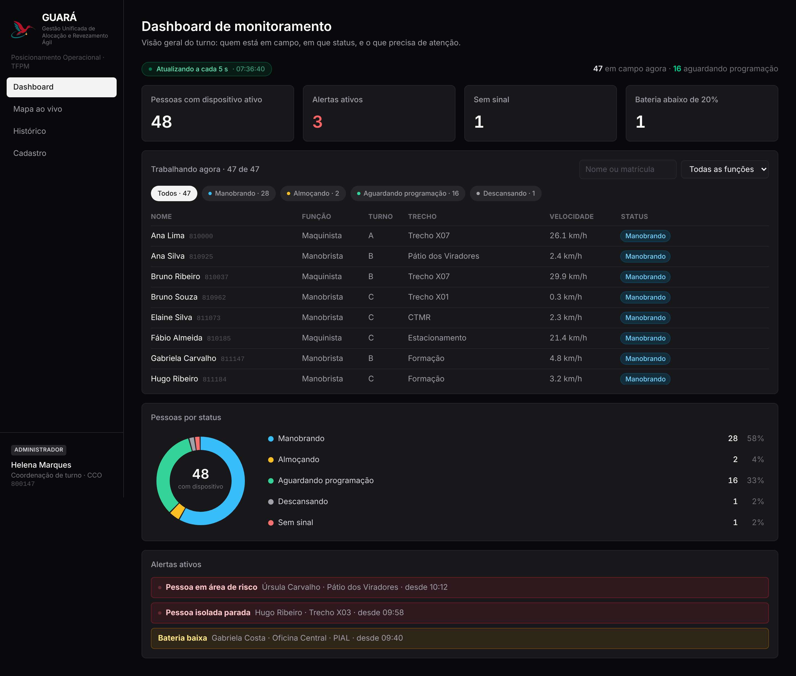
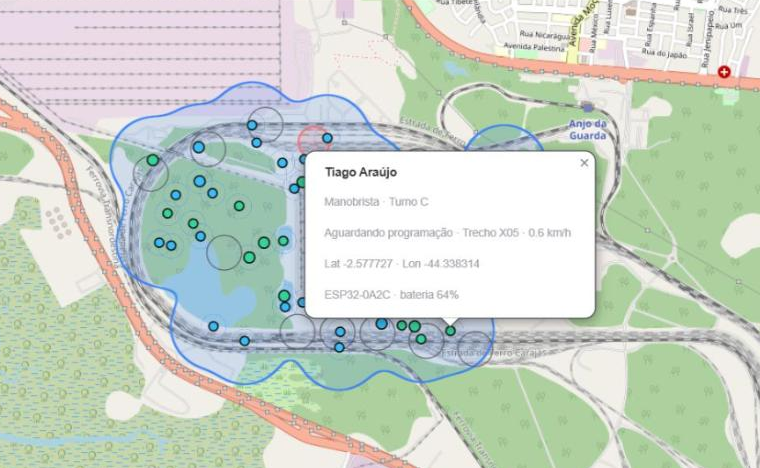
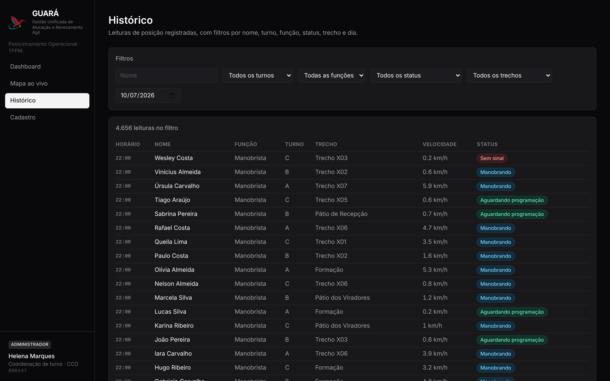
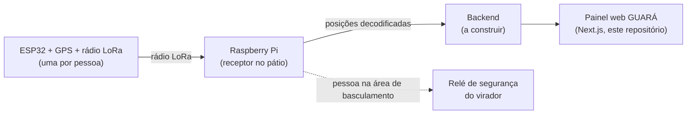

# KaizenDo · GUARÁ — Posicionamento Operacional Inteligente

    

> **EN:** GUARÁ is a 5-day prototype for Vale's KaizenDO innovation challenge at the Ponta da Madeira rail terminal (São Luís, Brazil). About 50 locomotive drivers and ground crew work across 13 km of yard and nobody knows exactly where each one is. Each person carries an ESP32 with GPS and a radio, a Raspberry Pi receives the positions, and a web panel shows who is where, who can reach a work front fastest and a history for the shift. **What is built here is the web panel, with illustrative data**; the hardware, the MQTT link and the safety relay are the proposed design. I led the team. The prototype was presented at the Pitch Day.

Solução para o desafio **Posicionamento Operacional Inteligente**, do programa **KaizenDO** da Vale, no Terminal Ferroviário de Ponta da Madeira (TFPM), em São Luís/MA.

| | |
|---|---|
| **Meu papel** | Líder da equipe: conduzi a concepção da solução e o desenvolvimento do protótipo, durante uma imersão de 5 dias na Estrada de Ferro Carajás, com visita de campo ao terminal |
| **Resultado** | Solução apresentada no **Pitch Day** do programa, com protótipo publicado e vídeo de demonstração |
| **Estado** | Protótipo **visual**, com dados ilustrativos. Não há backend, nem conexão com ESP32 ou Raspberry |
| **Feito com** | Next.js, React, TypeScript, Tailwind e Leaflet. Desenvolvido com apoio de agentes de IA (Claude Code), guiado por specs e ADRs em [`documentos/specs/`](documentos/specs/README.md) |

## Demonstração

https://github.com/user-attachments/assets/5d6ed487-bc94-40b0-8565-b04e0280e3df

A demonstração online está **fora do ar no momento**. Assista ao vídeo acima ou rode as telas localmente em três comandos (veja [Como rodar](#como-rodar)).

| Dashboard | Mapa ao vivo | Histórico |
|---|---|---|
|  |  |  |

Os nomes e as posições nas telas são **fictícios**.

## O problema em uma frase

Cerca de 50 maquinistas e manobristas por turno trabalham em 13 km de pátio, e ninguém sabe com precisão onde cada um está. Por isso, a escolha de quem acionar e o revezamento dependem da memória de quem coordena, e os vagões ficam parados esperando gente chegar.

## A solução em uma frase

Cada pessoa leva um **ESP32** (GPS + rádio LoRa) e um **Raspberry Pi** no pátio recebe a latitude, a longitude e a velocidade de todos. Com isso o sistema mostra onde está cada um, recomenda quem chega mais rápido a cada frente, guarda o histórico e, como extra de segurança, bloqueia o virador quando há alguém na área de basculamento. Nome de trabalho: **GUARÁ**.

## Arquitetura proposta



A posição é publicada por **MQTT** (decisão de 25/10) e a frequência recomendada é de **30 em 30 segundos** (hoje o envio é a cada 5 minutos).

| Parte | Situação |
|---|---|
| Painel web: dashboard, mapa ao vivo, histórico e cadastro | **Implementado** como protótipo visual (`codigo/frontend/`) |
| Tema claro e escuro, VLibras, layout de celular | **Implementado** |
| ESP32, Raspberry Pi, MQTT, relé de segurança | **Proposto**: especificado em [`documentos/docs/solucao.md`](documentos/docs/solucao.md), não construído |
| Backend, banco e recomendação de quem acionar | **Proposto**: o protótipo usa dados ilustrativos |

## Telas

| Tela | Rota | O que responde |
|---|---|---|
| Dashboard de monitoramento | `/dashboard` | Quem está em campo, em que status, quais alertas (área de risco, pessoa isolada, bateria baixa). Atualiza a cada 5 s |
| Mapa ao vivo | `/mapa` | Onde está cada pessoa nos trechos entre os "X" do pátio, com cobertura calculada |
| Histórico | `/historico` | Posições passadas com filtros |
| Cadastro | `/cadastro` | Vínculo pessoa ↔ ESP32 |

Não há tela de login: quem coordena abre a URL e o sistema já está funcionando. O operário não é usuário do sistema, ele entra como dado, pela tag que carrega ([por quê](codigo/frontend/src/app/cadastro/README.md#por-que-não-tem-login)).

## Decisões técnicas

- **Tema claro como padrão de quem visita**, escuro preservado como estado base: o claro entra como variante, nunca no lugar do escuro ([ADR 0001](documentos/specs/decisions/0001-tema-claro-por-variante.md), [ADR 0002](documentos/specs/decisions/0002-claro-como-padrao.md)).
- **Acessibilidade:** contraste AA (o cinza oficial da Vale não passa em AA para texto, então o claro usa tons mais escuros) e widget VLibras em todas as telas.
- **Mapa sem sobreposição:** cobertura com raio calculado em vez dos 3 km pedidos (cobriria tudo e a malha sumiria) e pontos afastados na tela em vez de agrupados, porque quem coordena precisa ver cada pessoa.
- **Envio de posição recomendado a cada 30 s:** a pé, uma pessoa anda cerca de 40 m em 30 s, bem menos que um trecho de 1,5 km, e o intervalo maior economiza bateria e rádio.
- **Falha segura no módulo de segurança:** se o sinal de quem estava na área se perde, o sistema assume que a pessoa continua lá e mantém o bloqueio.

## Limitações e próximos passos

- Não há testes automatizados; a verificação hoje é `npm run lint` e `npm run build`.
- As coordenadas dos trechos "X" divergem do diagrama oficial e aguardam pontos levantados em campo ([decisões em aberto](documentos/specs/open-decisions.md)).
- O backend, a ingestão por MQTT e a recomendação de quem acionar não existem ainda; a stack sugerida está em [`documentos/docs/solucao.md`](documentos/docs/solucao.md).
- Conferir o layout de celular em aparelhos reais (hoje só viewport emulado).

## Como rodar

```bash
cd codigo/frontend
npm install
npm run dev
```

Abra http://localhost:3000. Para validar: `npm run lint` e `npm run build`.

O cadastro fica no `localStorage` do navegador; em `/cadastro`, "Restaurar dados originais" volta ao estado inicial.

## Documentos

| Documento | Conteúdo |
|---|---|
| [documentos/docs/problema.md](documentos/docs/problema.md) | Contexto completo: terminal, operação, ficha oficial, descobertas da visita de campo, glossário, perguntas abertas e hipóteses |
| [documentos/docs/solucao.md](documentos/docs/solucao.md) | Solução explicada passo a passo, opções, protótipo, pitch e o módulo de segurança |
| [documentos/docs/telas.md](documentos/docs/telas.md) | Especificação das 4 telas e divisão por membro da equipe |
| [documentos/docs/slides/](documentos/docs/slides/) | Fotos dos slides da apresentação e do mapa oficial do terminal |
| [documentos/specs/](documentos/specs/README.md) | Memória técnica: arquitetura implementada, testes e decisões (ADRs) |

## Estrutura do repositório

```
documentos/              tudo que não é código
  docs/                    problema, solução, especificação das telas, slides, imagens
  specs/                   memória técnica: arquitetura implementada, testes e decisões (ADRs)
  slide/ video/            pitch e material de divulgação (não versionados)
codigo/                  tudo que roda (hoje só o frontend; o backend entra aqui)
  frontend/                telas (Next.js), uma pasta por membro da equipe → veja codigo/frontend/README.md
    src/app/dashboard/       Dashboard de monitoramento
    src/app/mapa/            Mapa ao vivo
    src/app/historico/       Histórico com filtros
    src/app/cadastro/        Cadastro pessoa ↔ ESP32
```

## Time

Sponsor: Lizandro Terceiro · Especialistas: Fernando Nunes, Andressa Chaves-Tharjes Lima, Rogerio Pereira · Estagiário: Itaio Conceição · SESI: Maria Alice · Universitários: Enzo Frazão (líder da equipe), Grazielli Diniz, Luick Vieira
